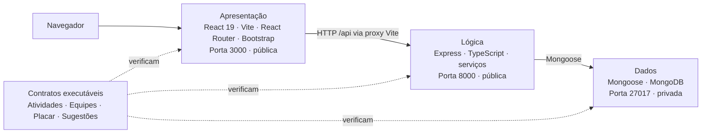

# Arquitetura do OctoFit Tracker

O OctoFit Tracker é uma aplicação de três camadas para um programa de atividades físicas escolar. O código inicial inclui contratos de API e pontos de implementação intencionalmente incompletos para que você use o modo agent do GitHub Copilot em um ciclo guiado por testes.

## Limites entre as camadas

- **Camada de apresentação**: React 19, Vite, React Router, Bootstrap e um cliente compartilhado da API em `octofit-tracker/frontend/src`.
- **Camada de lógica**: rotas e serviços Express com TypeScript em `octofit-tracker/backend/src` expõem o comportamento `/api/*` na porta `8000`.
- **Camada de dados**: modelos Mongoose e dados de demonstração em `octofit-tracker/backend/src/models` e `src/scripts/seed.ts` são persistidos no MongoDB na porta `27017`.

## Portas e regras de ambiente

- MongoDB: `27017` (privada)
- API Express: `8000` (pública)
- Interface Vite: `3000` (pública)
- O navegador acessa caminhos relativos `/api`. O Vite os encaminha para `http://localhost:8000`; `VITE_API_BASE_URL` pode substituir a URL-base.
- Não encaminhe nem torne públicas outras portas.

## Contrato da API

| Capacidade | Método e caminho | Comportamento esperado |
| --- | --- | --- |
| Registro de atividades | `GET /api/activities`, `POST /api/activities` | Lista e cria atividades válidas. POST recebe `userId`, `teamId`, `type` e `minutes`; `userId` e `teamId` devem ser IDs bem-formados de uma pessoa e uma equipe existentes, caso contrário a API retorna um 4xx intencional (nunca um 500 causado por erro de conversão). Uma atividade criada armazena `user`, `team`, `type` e `minutes` enviados, além de `points` e `occurredAt` calculados. |
| Equipes | `GET /api/teams`, `POST /api/teams` | Lista e cria equipes com integrantes. As equipes criadas e listadas mantêm os valores enviados em `name` e `mascot`. Rejeita uma equipe sem nome com `400`. |
| Placar | `GET /api/leaderboard` | Retorna as equipes ordenadas pela soma dos pontos de suas atividades, da maior para a menor. Cada item contém `teamName`, `totalPoints` e uma `rank` iniciada em 1. |
| Sugestões de treino | `GET /api/workouts/suggestions/:userEmail` | Recomenda treinos com base nos padrões de atividade recentes da pessoa correspondente ao e-mail seed. O foco da primeira sugestão (`focus`) corresponde à meta ou à atividade recente dessa pessoa, e o campo `reason` explica o motivo. Um e-mail sem pessoa correspondente retorna um 4xx intencional (por exemplo, `404`). |

## Decisões de implementação

- Decisão da camada de apresentação: cada tela consome o cliente compartilhado da API e apresenta estados acessíveis de carregamento, vazio e erro. A interface não acessa modelos nem o banco de dados.
- Decisão da camada de lógica: os serviços implementam validação e regras de negócio; as rotas Express traduzem os resultados para os envelopes e códigos HTTP do contrato. Entradas inválidas ou referências inexistentes retornam 4xx, nunca 500 por falha de conversão de ID.
- Decisão da camada de dados: modelos Mongoose definem campos obrigatórios, tipos e referências. O seed permanece idempotente e preserva registros não relacionados aos dados de demonstração.
- Abordagem para registro de atividades: validar tipo, minutos e IDs de pessoa/equipe, confirmando que as referências existem antes de gravar. Calcular `points` como os minutos válidos enviados e `occurredAt` no servidor; não aceitar esses valores como autoridade do cliente.
- Abordagem para gerenciamento de equipes: exigir `name`, manter `mascot` e os integrantes informados, e usar uma lista vazia quando `members` não for enviado. A resposta de criação e a listagem mantêm os valores enviados.
- Abordagem para o placar: somar os pontos das atividades por equipe, ordenar do maior total para o menor e atribuir posições começando em 1.
- Abordagem para sugestões de treino: localizar a pessoa pelo e-mail; priorizar o foco da atividade mais recente e, na ausência de atividade, usar `fitnessGoal`. Incluir uma justificativa legível; e-mail desconhecido retorna 4xx.

## Plano de testes

Linha de base observada em 2026-11-19, antes da implementação:

| Comando executado | Resultado | Significado das falhas |
| --- | --- | --- |
| `npm test --prefix octofit-tracker/backend -- --reporter=dot` | 8 falhas e 1 aprovação | Quatro falhas nos requisitos dos modelos; quatro nos contratos da API. O seed passou. As rotas de criação retornam `501` em vez de validar entradas, o placar está vazio e as sugestões não atendem ao contrato de foco/justificativa. |
| `npm test --prefix octofit-tracker/frontend -- --reporter=dot` | 15 falhas | As telas ainda exibem “Implementação pendente” e não atendem aos contratos de dados, carregamento, estados vazios e erros acessíveis. |

Após implementar cada camada, repetir primeiro o teste correspondente:

- Dados e seed: `npm run test:data --prefix octofit-tracker/backend`
- API: `npm run test:api --prefix octofit-tracker/backend`
- Frontend: `npm test --prefix octofit-tracker/frontend`

Verificações de compilação ainda não executadas nesta linha de base; executar antes de publicar:

- Backend: `npm run build --prefix octofit-tracker/backend`
- Frontend: `npm run build --prefix octofit-tracker/frontend`
